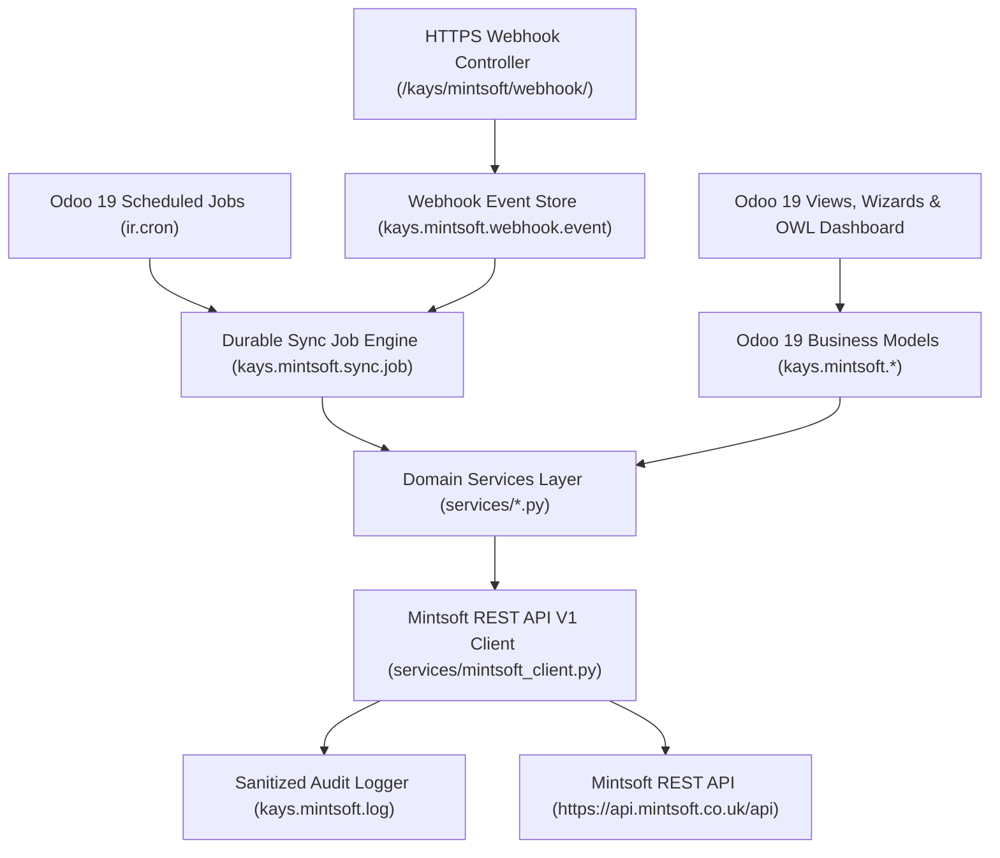

# Architecture Document — Kays Logistics (Mintsoft) Integration for Odoo 19 Enterprise

## 1. Overview

`kays_mintsoft_integration` is a production-grade, multi-company Odoo 19 Enterprise module integrating Odoo Sales, Inventory, and Delivery workflows with **Kays Logistics** via the **Mintsoft REST API V1** (`https://api.mintsoft.co.uk/api`).

Key architectural principles:
1. **Strict Multi-Company & Connection Isolation**: Every operational record (`kays.mintsoft.order`, `kays.mintsoft.shipment`, `kays.mintsoft.product.mapping`, `kays.mintsoft.carrier.mapping`, `kays.mintsoft.warehouse.mapping`, `kays.mintsoft.stock.snapshot`, `kays.mintsoft.stock.discrepancy`, `kays.mintsoft.sync.job`, `kays.mintsoft.log`, `kays.mintsoft.webhook.event`, `kays.mintsoft.return`) is scoped to `company_id` and `instance_id` (`kays.mintsoft.instance`), enforced by both Odoo Record Rules (`ir.rule`) and backend domain checks. Disabled companies never export orders or sync stock.
2. **Three-Mode Execution Engine**:
   - **Dry Run (`dry_run`)**: Read-only API calls permitted; all outbound write payloads are constructed, validated locally, sanitized, and stored in preview fields without making mutating HTTP calls to Mintsoft.
   - **Test Client (`test_client`)**: Uses a Kays-approved test client/account on live Mintsoft infrastructure with a dedicated order prefix (e.g., `TEST-`), isolated mappings, and mandatory operator acknowledgment that Mintsoft has no isolated sandbox hostname.
   - **Production (`production`)**: Live fulfilment operations, unlocked only via an explicit Administrator confirmation wizard (`kays.production.mode.wizard`).
3. **Backend-Enforced Feature Toggles**: 16 granular feature switches plus the master `enable_integration` switch on `kays.mintsoft.instance` are enforced at the service layer before any automated or manual action executes.
4. **Idempotent & Fault-Tolerant Order Submission**:
   - Uses deterministic external references (`S10216` or company-prefixed `MCUK-S10216`).
   - Enforces database uniqueness (`models.Constraint`) on `(instance_id, external_order_reference)` for primary orders.
   - Acquires PostgreSQL row locks (`SELECT ... FOR UPDATE NOWAIT`) before exporting to prevent concurrent duplicate submissions.
   - Queries Mintsoft (`GET /api/Order/Search` and `GET /api/Order/GetOrderId`) prior to submission and during reconciliation after network timeouts (`unknown_outcome` state).
   - Never automatically resends an order in `unknown_outcome` state until reconciliation confirms whether Mintsoft created the order.
5. **Split Order & Partial Fulfilment Support**:
   - `PUT /api/Order` returns an array of `NewOrderResult` objects (`[{"OrderId": ..., "OrderNumber": ..., ...}]`).
   - All returned Mintsoft Order IDs and subsequent split orders (`GET /api/Order/{id}/Splits`) are stored as linked `kays.mintsoft.order` records (`parent_kays_order_id` / `child_split_order_ids`) so earlier Mintsoft Order IDs are never overwritten.
6. **Safe Inventory & Picking Synchronization**:
   - Stock updates use Odoo 19's native `stock.quant` inventory adjustment mechanism (`with_context(inventory_mode=True)` + `action_apply_inventory()`), scoped strictly to the mapped Odoo stock location.
   - Delivery pickings (`stock.picking`) are never validated on intermediate Mintsoft statuses (`Received`, `Processing`, `Picked`, `Packed`); they are updated and validated (with backorder creation for partial shipments) only when verified shipment/dispatch evidence (`Despatched` status and/or `OrderShipment` records) is received.

---

## 2. Layered Component Architecture

### 2.1 Models Layer (`models/`)
- `kays.mintsoft.instance`: Connection profile, credentials, environment mode, 16 feature switches, stock safeguards, payment eligibility rules, webhook secrets.
- `kays.mintsoft.order` & `kays.mintsoft.order.line`: Operational fulfilment order headers, lines, split order hierarchy, export status, and mapped fulfilment status.
- `kays.mintsoft.status.mapping`: Maps Mintsoft `OrderStatusId` and `Name` to Odoo's canonical `fulfilment_status`.
- `kays.mintsoft.shipment` & `kays.mintsoft.tracking.event`: Shipment consignments, tracking numbers, courier services, label URLs, and granular tracking milestones.
- `kays.mintsoft.product.mapping`: Maps Odoo `product.product` variants to Mintsoft `ProductId` and `SKU`, including UoM conversion factors and bundle policies.
- `kays.mintsoft.carrier.mapping`: Maps Odoo `delivery.carrier` and destination region (UK Mainland, Northern Ireland `BT*`, Ireland, EU, International) to Mintsoft `CourierServiceId`.
- `kays.mintsoft.warehouse.mapping`: Maps Mintsoft `WarehouseId` (e.g., `3` - `Main Warehouse`) to Odoo `stock.warehouse` and `stock.location`.
- `kays.mintsoft.stock.snapshot` & `kays.mintsoft.stock.discrepancy`: Stock reconciliation runs, difference reports, threshold safeguards, and approval workflows.
- `kays.mintsoft.sync.job` & `kays.mintsoft.job.schedule`: Durable asynchronous job queue with exponential backoff, HTTP 429 `Retry-After` support, and dead-letter handling.
- `kays.mintsoft.log`: Sanitized HTTP and operational telemetry with configurable retention cleanup.
- `kays.mintsoft.webhook.event`: Incoming webhook event persistence, SHA-256 deduplication, and queued asynchronous processing.
- `kays.mintsoft.return` & `kays.mintsoft.return.line`: RMA creation, status polling, and inventory outcome tracking without unapproved automatic refunds.

### 2.2 Services Layer (`services/`)
- `mintsoft_client.py`: Low-level HTTPS client enforcing TLS certificate verification, host allowlisting (preventing SSRF and credential leakage), `ms-apikey` header injection, header/payload redaction, timeout classification, HTTP 429 `Retry-After` parsing, and `kays.mintsoft.log` recording.
- `order_service.py`: Eligibility evaluation, address/SKU/UoM/carrier validation, payload generation (`NewOrderWithItems`), duplicate checking, submission (`PUT /api/Order`), split-order capture, status synchronization, cancellation (`GET /api/Order/{id}/Cancel`), and amendments (`POST /api/Order/{id}` and item endpoints).
- `product_service.py`: Product discovery (`GET /api/Product/List`, `GET /api/Product/Search`), SKU lookup (`GET /api/Product/LookupProductId`), bundle inspection (`GET /api/Product/{id}/Bundle`), and optional product export (`PUT /api/Product`, `POST /api/Product`).
- `inventory_service.py`: Full and incremental stock fetching (`GET /api/Product/StockLevels`, `GET /api/Product/StockLevels/UpdatedSince`, `GET /api/Product/Inventory/Bulk`), UoM-aware comparison against Odoo `stock.quant`, discrepancy generation, safeguard evaluation, and auditable inventory adjustments.
- `shipment_service.py` & `tracking_service.py`: Retrieval of order shipments (`GET /api/Order/{id}/Shipments`), tracking events (`GET /api/Order/Shipments/TrackingEvents/List`), and safe synchronization with Odoo `stock.picking` (including partial delivery and backorder handling).
- `return_service.py`: Creation and synchronization of order returns (`POST /api/Return/CreateReturn/{OrderId}`, `POST /api/Return/{id}/AddItem`, `GET /api/Return/List`, `GET /api/Return/Reasons`).

---

## 3. Odoo 19 Enterprise Compatibility Standards

The module strictly adheres to Odoo 19 Enterprise specifications:
- Uses `models.Constraint` instead of the removed `_sql_constraints` attribute.
- Uses Odoo 19 3-tier security (`ir.module.category` -> `res.groups.privilege` -> `res.groups` via `privilege_id`).
- Uses `<list>` views instead of legacy `<tree>` tags, `<chatter/>` in form views, and inline Python expressions for `invisible`, `readonly`, and `required`.
- Uses `type='consu'` with `is_storable=True` for storable products and `_compute_quantity()` for UoM conversions without referencing removed `uom.category`.
- Omits removed `numbercall` and `doall` fields on `ir.cron` records.
